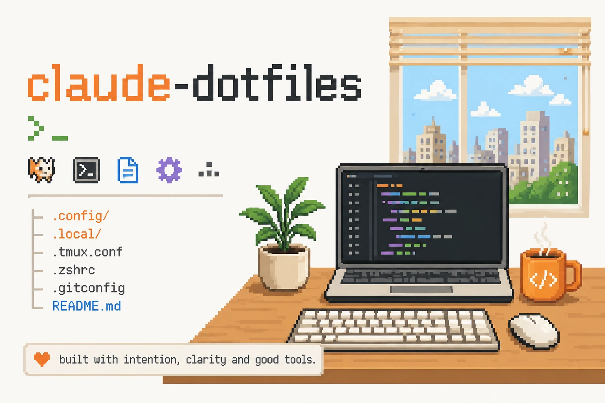

# claude-dotfiles



> Install everything by copying [INSTALL.md](./INSTALL.md) into Claude Code and following the prompt.

Personal Claude Code defaults for orchestrated software development. The primary agent investigates, plans, reviews, and approves. Three subagents handle implementation, runtime verification, and pull-request publication.

## Workflow

1. The primary agent investigates the repository and approves a concrete plan.
2. `opus-xhigh-implementer` implements and validates the plan.
3. The primary agent reviews the actual diff and sends substantive fixes back to the same implementer.
4. `opus-xhigh-evidence-verifier` runs the app locally, exercises the changed behavior, and captures screenshot and log evidence.
5. The primary agent performs final acceptance against that evidence.
6. `sonnet-pr-writer` creates the branch, commit, push, and pull request.

Small mechanical changes can stay in the primary agent when delegation would cost more than the work.

## CTO and Leads

To run several tickets at once, start `/cto` in a Herdr tab. The work has three levels, no more:

1. **CTO**: one session per Herdr space. It takes tickets, opens one Lead tab per ticket, keeps the queue and the status board, and relays each plan and blocker to you. It never reviews code.
2. **Lead**: one session per ticket, in its own tab. It runs `orchestrated-development` and owns the ticket from plan to pull request.
3. **Workers**: the three subagents above. The Lead calls them; they never get a tab.

You approve twice per ticket: the plan and the pull request. See [`cto`](./skills/cto/SKILL.md).

## Contents

```text
agents/
  opus-xhigh-implementer.md
  opus-xhigh-evidence-verifier.md
  sonnet-pr-writer.md
skills/
  cto/
    SKILL.md
  orchestrated-development/
    SKILL.md
  ste-explain/
    SKILL.md
INSTALL.md
```

- [`orchestrated-development`](./skills/orchestrated-development/SKILL.md) defines investigation, implementation, review, verification, and publication.
- [`cto`](./skills/cto/SKILL.md) coordinates one Lead per ticket in a Herdr space.
- [`ste-explain`](./skills/ste-explain/SKILL.md) writes explanations and plans in ASD-STE100 Simplified Technical English.
- [`opus-xhigh-implementer`](./agents/opus-xhigh-implementer.md) is the only write-heavy implementation worker (latest Opus, effort xhigh).
- [`opus-xhigh-evidence-verifier`](./agents/opus-xhigh-evidence-verifier.md) runs the app and captures evidence, without touching source (latest Opus, effort xhigh).
- [`sonnet-pr-writer`](./agents/sonnet-pr-writer.md) handles approved Git and pull-request operations (Sonnet, effort medium).

Verification evidence is written to `~/claude-workflows/<ticket-id-or-slug>/evidences`, outside every repository so it can never be committed into the pull request.

The primary model is whatever the Claude Code session runs (e.g. Opus/Fable). Each subagent pins its own model and reasoning effort in its frontmatter: the implementer and the verifier on the `opus` alias (always the latest Opus) at `xhigh`, the pull-request writer on `sonnet`.

## Workflow dependencies

- [Ponytail](https://github.com/DietrichGebert/ponytail) keeps implementations minimal.
- [Caveman](https://github.com/JuliusBrussee/caveman) provides concise communication and commit-message skills.

The installation prompt detects these dependencies and installs only what is missing. Their absence never blocks the workflow.

herdr-core (`hc`), the runtime behind the Herdr app, is optional. Only `/cto` needs it. The installation prompt reports when it is missing and does not install it.

## Installation model

The installer creates links only for files owned by this repository:

```text
~/.claude/skills/orchestrated-development
~/.claude/skills/cto
~/.claude/skills/ste-explain
~/.claude/agents/opus-xhigh-implementer.md
~/.claude/agents/opus-xhigh-evidence-verifier.md
~/.claude/agents/sonnet-pr-writer.md
```

It does not link or replace the whole `~/.claude` directory, so authentication, history, settings, memory, other agents, and other skills remain local.

See the official Anthropic documentation for [skills](https://code.claude.com/docs/en/skills) and [subagents](https://code.claude.com/docs/en/sub-agents).
