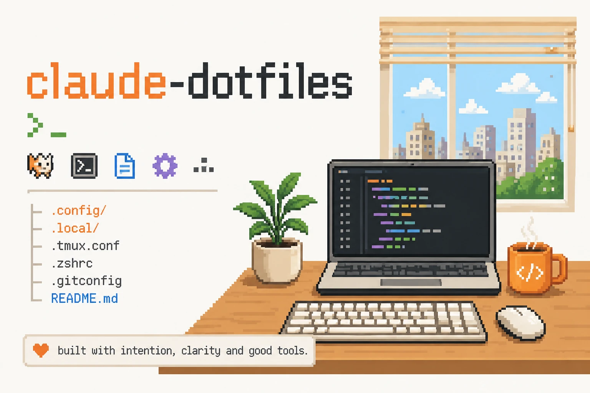

# claude-dotfiles



> Install everything by copying [INSTALL.md](./INSTALL.md) into Claude Code and following the prompt.

Personal Claude Code defaults for orchestrated software development. The primary agent investigates, plans, reviews, and approves. Four subagents handle the tests written first, implementation, verification, and pull-request publication.

## Workflow

1. The primary agent investigates the repository and approves a concrete plan. For a bug, `opus-xhigh-evidence-verifier` first reproduces it twice, without forcing the symptom.
2. `opus-xhigh-tdd-expert` writes the unit tests first: tests that pass for the existing code the plan changes, and tests that fail for the new behavior.
3. `opus-xhigh-implementer` implements the plan until all those tests pass, without editing them.
4. The primary agent reviews the actual diff and sends substantive fixes back to the same implementer.
5. `opus-xhigh-evidence-verifier` runs both test groups, then runs the app locally, exercises the changed behavior, and captures screenshot and log evidence. For a bug, it runs the scenario twice, and the bug must show in neither try. A later re-verify, after a fix, runs only the scenarios that the fix can change.
6. The primary agent performs final acceptance against that evidence.
7. `sonnet-pr-writer` creates the branch, commit, push, and pull request.

Small mechanical changes can stay in the primary agent when delegation would cost more than the work.

## CTO and Leads

To run several tickets at once, start `/cto` in a Herdr tab. The work has three levels, no more:

1. **CTO**: one session per Herdr space. It takes tickets, opens one Lead tab per ticket, keeps the queue and the status board, and relays each plan and blocker to you. It never reviews code.
2. **Lead**: one session per ticket, in its own tab. It runs `orchestrated-development` and owns the ticket from plan to pull request.
3. **Workers**: the four subagents above. The Lead calls them; they never get a tab.

You approve twice per ticket: the plan and the pull request. Every 30 minutes, the CTO tells you whether it needs you and for what. See [`cto`](./skills/cto/SKILL.md).

After the pull request opens, the Lead waits with [`pr-watch.sh`](./skills/orchestrated-development/pr-watch.sh), a read-only script that uses no tokens while it waits and wakes the Lead only when the pull request changes. After the merge, the CTO runs [`worktree-sweep.sh`](./skills/cto/worktree-sweep.sh): it removes each worktree whose pull request is merged, and its local branch, and keeps any worktree with changes, unmerged commits, or a running process.

Optional: in a CTO session, [`auto-intake`](./skills/auto-intake/SKILL.md) runs tickets without you at the plan gate. `/auto-intake <TICKET> ...` takes the tickets you pick; `/auto-intake --watch <source>` picks the TODO tickets assigned to you. Each ticket passes a set of gates (still yours, no existing fix, clear goal, reproduces, bounded impact, blast radius not red, no product decisions) and a 10-minute veto window. The blast radius follows who already uses the changed code, not the topic: red (existing users' auth, migrations of existing rows, billing, real emails, production config) goes to you; yellow (new surfaces behind an off flag, narrow security fixes, additive schema) runs alone with a main-vs-branch regression for every existing persona; green runs alone. Any no sends the plan to you as usual. You still approve every pull request.

The optional [`cto-board`](./herdr/mods/cto-board/main.js) Herdr mod opens beside the CTO chat and shows the same board live: what needs you, each Lead's stage, the queue, and recent activity from the state files. It is read-only.

## Contents

```text
agents/
  opus-xhigh-tdd-expert.md
  opus-xhigh-implementer.md
  opus-xhigh-evidence-verifier.md
  sonnet-pr-writer.md
skills/
  auto-intake/
    SKILL.md
  cto/
    SKILL.md
    worktree-sweep.sh
  orchestrated-development/
    SKILL.md
    pr-watch.sh
  ste-explain/
    SKILL.md
herdr/
  mods/
    cto-board/
      main.js
      parse.js
INSTALL.md
```

- [`orchestrated-development`](./skills/orchestrated-development/SKILL.md) defines investigation, tests first, implementation, review, verification, and publication.
- [`cto`](./skills/cto/SKILL.md) coordinates one Lead per ticket in a Herdr space.
- [`auto-intake`](./skills/auto-intake/SKILL.md) lets the CTO approve plans itself for tickets that pass its gates.
- [`ste-explain`](./skills/ste-explain/SKILL.md) writes explanations and plans in ASD-STE100 Simplified Technical English.
- [`opus-xhigh-tdd-expert`](./agents/opus-xhigh-tdd-expert.md) writes the unit tests before the implementation, and only tests (latest Opus, effort high).
- [`opus-xhigh-implementer`](./agents/opus-xhigh-implementer.md) is the only write-heavy implementation worker (latest Opus, effort xhigh).
- [`opus-xhigh-evidence-verifier`](./agents/opus-xhigh-evidence-verifier.md) runs the app and captures evidence, without touching source (latest Opus, effort xhigh).
- [`sonnet-pr-writer`](./agents/sonnet-pr-writer.md) handles approved Git and pull-request operations (Sonnet, effort medium).

Verification evidence is written to `~/claude-workflows/<ticket-id-or-slug>/evidences`, outside every repository so it can never be committed into the pull request.

The primary model is whatever the Claude Code session runs (e.g. Opus/Fable). Each subagent pins its own model and reasoning effort in its frontmatter: the implementer and the verifier on the `opus` alias (always the latest Opus) at `xhigh`, the TDD expert on `opus` at `high`, the pull-request writer on `sonnet`. Under a CTO, Leads run at effort `high`. The agent names keep `xhigh` so that running sessions keep working.

## Workflow dependencies

- [Ponytail](https://github.com/DietrichGebert/ponytail) keeps implementations minimal.
- [Caveman](https://github.com/JuliusBrussee/caveman) provides concise communication and commit-message skills.

The installation prompt detects these dependencies and installs only what is missing. Their absence never blocks the workflow.

herdr-core (`hc`), the runtime behind the Herdr app, is optional. Only `/cto` needs it. The installation prompt reports when it is missing and does not install it.

## Installation model

The installer creates links only for files owned by this repository:

```text
~/.claude/skills/orchestrated-development
~/.claude/skills/cto
~/.claude/skills/auto-intake
~/.claude/skills/ste-explain
~/.claude/agents/opus-xhigh-tdd-expert.md
~/.claude/agents/opus-xhigh-implementer.md
~/.claude/agents/opus-xhigh-evidence-verifier.md
~/.claude/agents/sonnet-pr-writer.md
```

It does not link or replace the whole `~/.claude` directory, so authentication, history, settings, memory, other agents, and other skills remain local.

See the official Anthropic documentation for [skills](https://code.claude.com/docs/en/skills) and [subagents](https://code.claude.com/docs/en/sub-agents).
